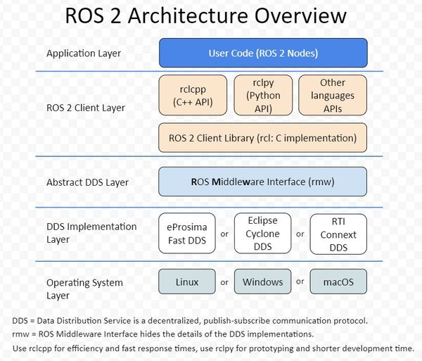
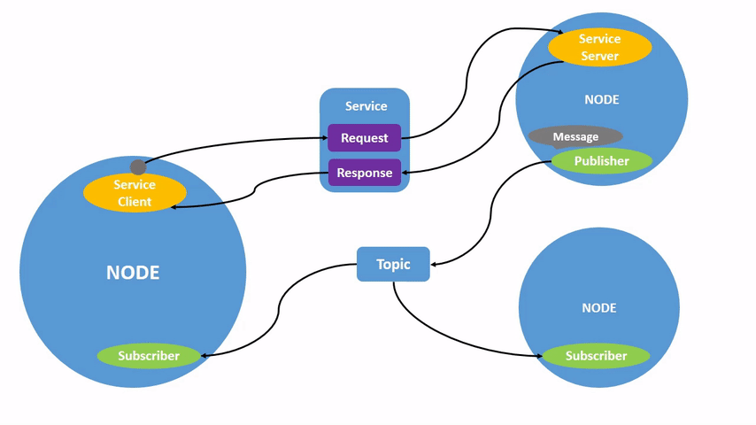
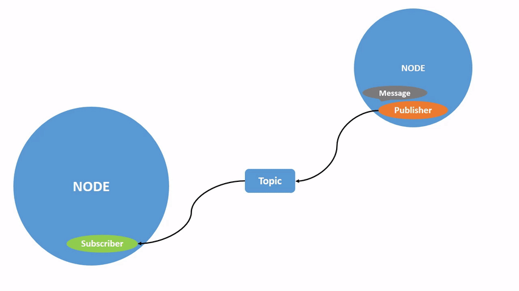
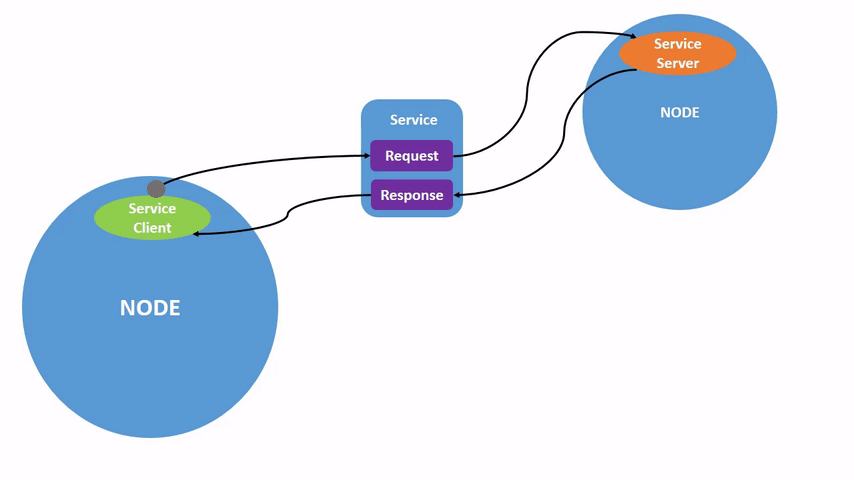

# ROS 2 Fundamentals Workspace


A compact, hands-on ROS 2 workspace that implements the core concepts as small,
runnable examples in **Python** and **C++**, connected through custom interfaces
and launch files.

**Learning objectives:** understand nodes, topics, services, actions, parameters,
QoS, executors, callback groups, lifecycle nodes, composition and launch files —
and run, observe and test each one from the ROS 2 CLI.

## Table of Contents

- [Overview](#overview)
- [Technologies](#technologies)
- [Project Structure](#project-structure)
- [Topics Covered](#topics-covered)
- [Python vs. C++](#python-vs-c)
- [Installation & Build](#installation--build)
- [Run Examples](#run-examples)
- [Screenshots](#screenshots)
- [Known Issues](#known-issues)

## Overview

ROS 2 splits a robot application into independent **nodes** that communicate
through standardized interfaces. This workspace demonstrates each building block
in isolation first, then shows how they combine into small applications
("apps") that can be started with a single launch file.



## Technologies

| Tool | Version / role |
|---|---|
| ROS 2 | Humble Hawksbill |
| OS | Ubuntu 22.04 LTS |
| Languages | Python 3.10, C++17 |
| Build | `colcon`, `ament_cmake`, `ament_python` |
| Interfaces | `rosidl` (msg / srv / action) |
| Tooling | `rqt_graph`, `ros2` CLI |

## Project Structure

```text
ros2_ws/
├── src/
│   ├── bringup/            # launch files: combined Python + XML "apps"
│   ├── custom_interfaces/  # msg / srv / action definitions
│   ├── my_cpp_pkg/         # C++ examples
│   └── my_py_pkg/          # Python examples
├── docs/
│   └── WORKSPACE_AUDIT.md  # full findings (severity, locations, fixes)
├── media/                  # diagrams and animated GIFs
└── README.md
```

## Topics Covered

| Topic | Purpose | Package / example |
|---|---|---|
| Nodes | Independent units of computation | `my_py_pkg/my_node`, `my_cpp_pkg/my_node` |
| Topics | Asynchronous publisher/subscriber | `simple_publisher`, `simple_subscriber` |
| Custom messages | Typed data (`HardwareStatus`) | `custom_interfaces`, `*_status_*` |
| Services | Request/response | `simple_service_server`, `simple_service_client` |
| Custom services | `SetLed`, `ComputeRectangleArea` | `led_panel`, `compute_rectangle_area_*` |
| Actions | Long-running goals with feedback | `simple_action_*`, `count_until_*`, `move_robot_*` |
| Parameters | Runtime configuration & validation | `simple_parameter` |
| QoS | Reliability, durability, depth | `simple_qos_publisher`, `simple_qos_subscriber` |
| Executors | Single vs. multi-threaded scheduling | `simple_single/multi_threaded_executor` |
| Callback groups | Reentrant / mutually exclusive | used by multi-threaded executors & actions |
| Lifecycle nodes | Managed state transitions | `simple_lifecycle_node`, `lifecycle_node_manager` |
| Composition | Multiple nodes per process | Python `container`, C++ `manual_composition`, `*_component` |
| Launch files | Start systems declaratively | `bringup/launch/*.launch.py` and `*.launch.xml` |

## Python vs. C++

| Topic | Python (`my_py_pkg`) | C++ (`my_cpp_pkg`) |
|---|---|---|
| Node / pub / sub | ✅ | ✅ |
| Number pipeline | ✅ publisher, counter, subscriber | ✅ publisher, counter |
| Robot news / smart phone | ✅ | ✅ |
| Custom messages + services | ✅ (incl. rectangle area) | ✅ services; no rectangle area |
| Actions (Fibonacci, CountUntil, MoveRobot) | ✅ | ✅ |
| Parameters | ✅ | ✅ |
| QoS | ✅ | ✅ |
| Executors | ✅ | ✅ |
| Lifecycle | ✅ | ✅ |
| Composition | ✅ `container` | ✅ `manual_composition`, component |

## Installation & Build

```bash
source /opt/ros/humble/setup.bash
colcon build --symlink-install
source install/setup.bash
```

## Run Examples

Individual nodes:

```bash
ros2 run my_py_pkg simple_publisher
ros2 run my_py_pkg simple_subscriber
ros2 run my_cpp_pkg simple_publisher
```

Combined apps (each available as `.launch.py` and `.launch.xml`):

| App | Demonstrates |
|---|---|
| `chatter_app` | publisher + subscriber |
| `number_app` | number pipeline with remapping |
| `radio_app` | multi-instance broadcast + receiver |
| `hardware_status_app` | custom messages |
| `services_app` | standard + custom services |
| `led_app` | service + state machine (`led_panel` + `battery`) |
| `actions_app` | three action servers |
| `parameters_app` | runtime parameters |
| `qos_app` | QoS overview |
| `executors_app` | single vs. multi-threaded |
| `composition_app` | multiple nodes in one process |
| `lifecycle_app` | lifecycle node + manager |
| `python_app` / `cpp_app` | all Python / all C++ demos |
| `all_app` | top-level entry point |

```bash
ros2 launch bringup chatter_app.launch.py
ros2 launch bringup number_app.launch.xml
ros2 launch bringup all_app.launch.py
```

> Python and C++ demos share topic/service/action names, so run one language at a
> time. See `docs/WORKSPACE_AUDIT.md` for details.

## Screenshots

| Nodes | Topics |
|---|---|
|  |  |

| Services | Actions |
|---|---|
|  |  |

Additional diagrams: `media/ros2_architecture.png`, `media/qos.png`,
`media/lifecycle_node.png`, `media/actions_state_machine.png`.

## Known Issues

Full findings are in [`docs/WORKSPACE_AUDIT.md`](docs/WORKSPACE_AUDIT.md). Key items:

| ID | Severity | Summary | Location |
|---|---|---|---|
| AUD-001 | High | Component plugin name mismatch — executable starts but creates no node | `my_cpp_pkg/CMakeLists.txt:131` |
| AUD-002 | High | `/number` type mismatch (`example_interfaces` vs `std_msgs` Int64) | `number_publisher_component.cpp:12` |
| AUD-003 | Med-High | `battery` (C++) never joins worker threads → `std::terminate` on exit | `battery.cpp:79` |
| AUD-004 | Medium | LED topic differs: `led_panel_state` (py) vs `led_states` (cpp) | `led_panel.cpp:12` |

## License

Educational and portfolio use.
